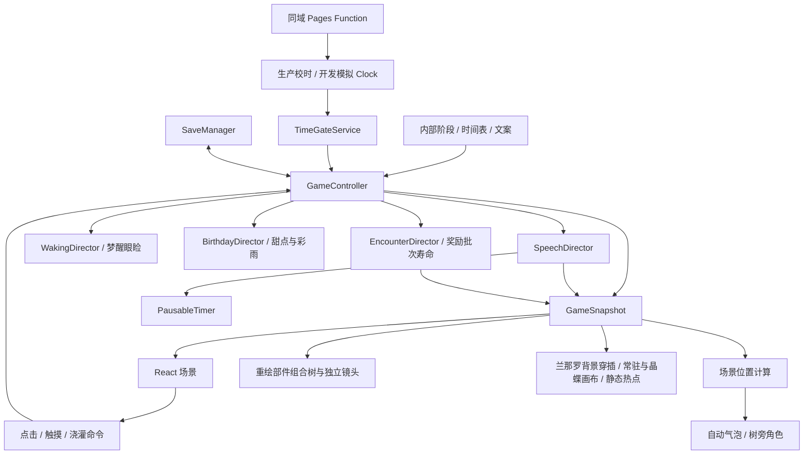

# 工程架构 · 连续交互版

本轮：Notice支持Markdown“> ”tagline并移到正文底部；N01由原稿生成。proceduralTree是GameSnapshot临时标志，TreeRenderer保留原唯一GSAP游标，通过proceduralGrowthAtFrame按当前58拍映射同等成长，替换实绘SVG枝叶；presentedTreeBounds统一两种形态的对白 / 表情 / 施法，晶蝶只换稳定落点，不改解锁。E技能采用clean-v2派生哈希纹理，原骨骼 / atlas / 时序保留，见PROCEDURAL_TREE.md / E_SKILL_CLEAN.md。

2026-10-26呈现：InteractionCue以小SVG / CSS取代三处可见提示文字，保留读屏说明与暂停 / 减少动态；watering提示嵌在实际按钮内，不另估算屏幕落点。model按当前附件给tree01 / tree1及附着叶片统一16单位落地修正，timeline源矩阵不动；TreeRenderer共享一个固定根领局部mask / clip，融合独立前景硬边，不用于叶片生长。开发预览走原ExpressionDirector，仅临时播放，不改存档 / 概率 / 配额；见TREE_GROUNDING.md。

种植接入：GameController持有可暂停planting时钟和临时seedPhase，SaveManager仅持久化seedPlanted布尔收据。IntroScene种子进入DreamTreeScene时复用原背景onBackgroundFrame活动时间更新CSS变量，SeedPlanting用CSS完成垂直落下与末段渐隐，不增加RAF / 画布 / WebGL。canExplore、water、reconcile、requestVisit及闲置 / 表情均验证种植，落地后才进入原入场对白与收露流程。旧档迁移、刷新与引导详见SEED_PLANTING.md。

最新固定场景层：useSceneViewport替代相机控制器，仅保留ResizeObserver和轻扫误触保护；不再创建额外视角时钟 / 滚轮 / 平移监听。scenePlacement.ts统一sceneRoot与treeCanopyFocus，维持原设备缩放，根 / 地面固定，可见冠中部用于气泡 / 表情 / 祝福；只读高层presentation及原A背景入口时钟保持。详见FIXED_TREE_VIEW.md。

本轮将部分E/F演出前移：浇灌次数 / 每次20点 / 日期上限不变，C九浇终点为grow30、D八浇为grow41；E八浇结束于grow45成簇拍，F十浇仍完成grow51及最后7点无动画。原51条木质轨各完整一次，grow42～48分成芽 / 舒叶拍与0.25秒独立成簇拍，共58拍，不停住半次回弹。 growthRoute将预算与raw轨分离，presentation提供唯一实际帧模型；原111枝位与资源规格不变，实际验证见TEST_PLAN.md。

## 可组合世界树

实际grow34起的111枝位保留稳定身份而非固定世界坐标；当前body语义UV随完整仿射回弹，原attachment cut才切位，新芽等真实cut后弹出，不提前搬往未来树顶。阶段标签不再控制枝叶接管，D580已接续15处，随后按原birth / leafAt排程长成111处；逐浇 / 分拍见TREE_SEQUENCE_REVIEW.md。

tree/growthRoute.ts把floor(growth / 20)作为预算索引查58拍路线，不再直接作为raw grow。TreeGrowthFrame的index / time对应beat，treeGrowthBeat给raw step / pass / duration，treeGrowthPlayback从实际帧串播全部剩余拍；growth.ts兼容导出step / duration。C/D部分一浇两轨按原秒数完整播放，42～48 leaves播放一次木质及芽 / 舒叶、保留待成簇旧叶，clusters在木质终态只播放完整0.25秒簇；不重复木质或冻结半回弹。presentation.ts的treeGrowthFrameModel / createTreeGrowthModel统一当前拍部件、真实alpha / 冠锚和只读终态，实际grow>=34接管，growth可重建、无新存档。原timeline / leafAnchors / 111点foliageLayout / 96新枝foliagePlan与模板0.5 / 0.25秒保持；full / leaves时长覆盖max(body,delay+clip)。唯一GSAP、控制器 / 表情等待 / 暂停与最后7点不变，树高 / 气泡 / 施法 / 晶蝶统一同一presentation，见TREE_SYSTEM.md。

## 声明与每页选图

`SessionHost` 持有 FirstVisitNotice，实际首访公告可见时才写独立收据；App 等开场资源 / 揭幕结束、前台横屏再开面板，在此之前挂起游戏。临时会话重挂共享收据，不因 test / Birthday 再自动弹出。正文标题来自 Markdown，手动铃铛和原 Modal 暂停 / 焦点 / 竖屏机制保持。

Birthday 通过异步 session 工厂创建独立内存 SaveManager / 私有时钟，原 App 清理后以唯一 generation 重挂，初态已是 FG cover；原服务器 / 开发时钟及正式存档不写入。G 临时预览不显示额外调试工具，不改变普通阶段资格，详见 EASTER_EGGS.md。

有效浇灌通过 `interruptTreeReplies` 清理旧树回应 / 普通欢迎 / 待机，并调用 SpeechDirector.interruptTree；只清当前打字 / 阅读 / 表情计时，不调旧完成 / 已读、不清已结束来访的 presence。新树句直接播放，动作仍用原 cultivation 时钟；角色 / 祝福和 opening / transition 事务受保护，期间只保留最新待播树句。无效浇灌不打断，抽签 / 资源结算不回退。

`src/content/notice.md?raw` 经最小纯文本解析交给 Notice / 原 Modal，安全行内链接可参与焦点约束。首屏局部 `introPanel` 不改变日期权限；梦境 / 现实临时 `notice` 复用面板暂停、panelResumeMode 与剩余演出时钟，音乐 / 音效 / 表情同时暂停。关闭返回对应铃铛入口；无新持久字段、原生 dialog 或渲染上下文，见 NOTICE.md。

`prepareOpeningAssets()` 每个控制器开场只重抽一次插图，忽略旧选择、提交合法 ID 后再生成本页下载计划；布局 / 后台恢复不重抽，刷新创建新控制器后重新抽。有效压缩响应缓存仍复用，未改变对白抽选、收据、成长或服务器门控。G 静态底图仅去额外缩放 / 位移并底部对齐最小 cover，A～F 镜头保持。

## G 生日来信

`RealityScene` 的四信封使用独立的可暂停轻晃计时器，不占用对白随机源。`GameController.openBirthdayMail()` 验证 G idle / 无祝福事务后进入临时 mail，统一挂起底层对白、表情和闲置；App 以普通 body Portal 书页承接输入，背景 inert。`BirthdayMailDirector` 的单 PausableTimer 管理启封 / 展开 / 淡换 / 回收 / 合封，它只接受真实后台 / 竖屏挂起，不把底层 mail 暂停误传给自己。

来信文本由独立 MD 解析为生成 JSON，不进入自动对白池或 v2。书页 / 导航 / 当前设备单档贺图纳入压缩响应预载，仅当前一年 img 解码，书底使用原透明 PNG 的派生；无新增 Canvas / GL / RAF。退出 / 卸载取消回调，完整合封后恢复焦点 / 原句剩余时间，G 闲置从零 20 秒。源码、状态图式时序与素材清单见 BIRTHDAY_MAIL.md。

## 首屏展现

首屏右上设置与其左侧声明为局部面板开关，不改变GameController的intro权限或挂载未开放场景；校时自动恢复离开intro时清理开关。设置与正确代码反馈均Portal到body，反馈不受OpeningShell的隔离层压住。手机在开放前也能输入Past，切入独立内存会话，不写正式存档；详见EASTER_EGGS.md。

IntroScene展示邀请 / 入口 / 声明与未种下的种子；App捕获实际种子包络后调用原onEnter权限判定，种植阶段独立于背景和树成长。intro.css 在 backgrounds.css 之后加载，样式全部局限 .intro-* / .enter-dream，不改变游戏气泡、镜头 / 背景或其他按钮。清晰深绿文字替代浅字深阴影，深绿浅金入口与原叶徽统一；横屏预留提示 / 页脚空间，缺图浅绿底、强制色系统配色。新字符按原 TTF 重生常用 / 扩展 WOFF2，原稿与存档不动。

## 依赖关系

`src/main.tsx` 注入时钟与存档。业务不依赖 React 闭包；React 通过 `useSyncExternalStore` 读取不可变快照。公开测试构建保留模拟时钟 / 面板的动态分块，不在正式会话主动加载；SessionHost 收到 Past 后卸载旧 App 并创建独立内存会话，正式 ServerClock 与存档不被模拟工具改写。

## 音乐与字体

来访额外句独立为 `visit-followup` 事务：自然预约附在 `visitLines`，主来访先完成原一次结算；SpeechDirector 保留角色并暂停离场，原句 / 施法后优先接话，追加结束只重设停留、不再祝福。刷新从原收据恢复未读句及表情 / 位置，不新建自然visit。ExpressionDirector 允许梦境角色锚点，仍只有单个当前表情。G 的 BirthdayMailArt 按源 keyed，缓存 complete / decode 与过期回调各自隔离；只挂当前图，不调浅原色。G 音乐复用同一个 MusicManager / media，未新增播放器或集中音频预载。

来访音直接订阅 SpeechDirector 的真实 arrive 状态边沿，不依赖角色 React 重绘。Rainstorm 在成功生成 40 颗后发声，面板内输入暂存单次声音意图，closePanel 恢复演出后播放；后台 / 竖屏 / 换景 / 清理丢弃，不持久化。两条新声沿用 SoundManager、共享 BGM 上下文与原独立音量，没有新播放循环。开场进度条和百分比在同一 wrapper 内按相同条件挂载，无额外计时器；G 不再挂载两层树影，七份礼物共用原两张透明图。

交互音效已替换合成铃声：GameController 的 `subscribeSound` 发送成功动作，EncounterDirector 区分自然入退 / 点击；App 同步设置、作用域和暂停配置 SoundManager。七份 AAC 以小 JSON / base64 开场只下载、动作时解码（128 KiB / 5s 校验）、缓存解码，避开 IDM 对媒体 fetch 的接管；共用 BGM 唯一 AudioContext，但独立总线 / 压缩器、六声上限与收露节流，不增 HTMLAudioElement / RAF。0、面板 / 后台 / 竖屏、换景清理，旧请求不补响。v2 新增 soundVolume、保留旧 sound 关闭；真实转场一次传送，不根据重绘 / 进度猜测。来源与授权见 INTERACTION_AUDIO.md。

`App` 用场景 / 回访、设置、面板、揭幕、后台和竖屏状态配置独立 `MusicManager`，不让音频承诺阻塞 GameController。一个 HTMLAudioElement 流式加载当前曲，与 SoundManager 共用惰性 AudioContext / GainNode 包络；8 秒初入留白、12 秒曲间留白使用 PausableTimer，隐藏立即暂停，面板 / 手动暂停保留播放位置。原按钮图片仅真实播放时旋转，重试手势与全页捕获授权分离，避免一次点击被先授权后误切关闭；失败不自动重试。G 同样使用 G.mp3 派生曲，v2 settings.music 默认 true、musicVolume 默认 0.45，旧音效偏好不变。右上直接设置，设置不再含手记入口，跨面板不恢复时钟，Modal 最终回退设置入口焦点。MusicManager 区分 waiting 留白、loading 请求 / 解码、buffering 播放中等待，以原生 title / aria-description 提示，不伪造网络百分比；音量变化不换曲 / 重置留白，0 静音并保留上次正音量。无新 RAF / 画布或运行依赖。

全局 `--font-game` 指向 Irminsul，源为原神0.87.ttf 的同字形 WOFF2。`prepare-fonts.py` 扫描当前正文生成常用包和互斥 unicode-range 扩展包；index 通过 Vite 构建插件预载当前哈希常用包，不预载罕见字。font-display: swap 与已有 DOM 量尺 / 字体事件协作，保持两行和全部原文，不阻塞开场。音频 / 字体脚本、资源哈希与具体规则见 AUDIO_AND_FONTS.md。

## 两条独立流程

启动揭幕是两条游戏流程之外的页面生命周期门：`OpeningReveal` 保留实际 App / DOM，inert + aria-hidden 锁定输入，以 clip-path 方窗和源图案的 12 条 Web Animations 揭示页面，不缩放真实内容。App 的 layout effect 在 game.start 前设置 suspended；完成后解除，原待播 / 存档继续，不新增游戏模式或权限来源。正常 5800 ms、单印 2850 ms，图案缩小 20%、使用右上角四叶印从左屏外抛入，沿页面中线阻尼弹跳，第三次主触底后微弹三次再水平滚向中央、横竖对齐后在中央静停 600 ms 再分裂；后台动画 / 完成计时一起暂停，尺寸变化仅重设 keyframes；减少动态 / 缺图 / 900 ms 等待超时短淡入，API 失败可直接解锁。全部结束 / 卸载清理，不增画布 / GL / RAF，见 OPENING_ANIMATION.md。 横移 / 旋转共用一阶连续曲线，保留屏宽 16% / 27% / 34% 三处主落点；微弹期间保留水平动量，落稳直接滚动，不停车再加速。

交互状态为 `intro / idle / watering / growing / ending / journal / settings / loading / waking`。普通循环仍为 `idle → watering → growing → idle`，对白与来访不占交互状态；仅真正换景在门槛 / 旧段队列结束后进入 loading，先覆盖再改 stage。getActiveStage 为资格、sceneStage 为持久展示收据，StageLoadingDirector 独立暂停进度及完成时钟；真实目标 / 有界回退就绪后释放，详见 STAGE_LOADING.md。 journal 仅兼容旧内部 API，不再渲染玩家手记。首次 F→G 在 loading 后由 WakingDirector 完成 6 秒眼睑遮罩，最后才提交 G sceneStage；BirthdayDirector 与原 U 同步送礼 / 彩雨，原 N 只等待未完演出余量，SpeechDirector.prepare 保持同一事务等待，见 REALITY_CELEBRATION.md。

`SpeechDirector` 单独管理自动气泡、角色浮现 / 观察 / 离开和阅读完成回调。快照中的 `speech`、`companion` 与 `event` 是这一流程的呈现，不锁定收露、浇灌、镜头或面板。

重要模块：

- `game/core/GameController.ts`：成长事务、边界推进、资格队列、资源反馈、恢复与清理。
- `game/dialogue/SpeechDirector.ts`：逐句 / 逐段自动播放、独立悬停停留、淡出、已读记录和来访动作。
- `game/dialogue/textPlayback.ts`：句号 / 问号 / 叹号完整边界的均衡分段（最多两段）、弱 / 强标点时间线和可见字符二分查找。
- `data/dialogueSource.ts`、`scripts/prepare-dialogues.mjs`：解析用户原稿、校验唯一编号 / 生成正文；兼容 A[13456] 等标题并提取 treeExpressions，句中数字标记解析为 expressions / UTF16 offset，正文不显示标记，原文件与非数字括号保留，prebuild 自动更新，不维护第二套文本。
- `data/dialogues.ts`、`game/dialogue/DialogueSystem.ts`：正文索引、概率 / 配额、无放回抽签和持久剩余池，详见 DIALOGUE_SYSTEM.md。
- `game/core/PausableTimer.ts`：只保留一个待执行回调和剩余时长，支持暂停 / 恢复 / 清理。
- `data/presentation.ts`：打字、最低阅读停留、淡出、观察和梦醒时长。
- `game/growth/`：成长规则、内部阶段推导和世界高度。
- `game/time/`、`game/save/`：时间权限与持久化。
- `functions/api/time.ts`、`server/timeEndpoint.ts`：同域服务器时间协议与无缓存响应；`server/timePlugin.ts` 为 Vite 开发 / 预览提供相同端点，不编入浏览器代码。
- `game/camera/sceneLayout.ts`：不同视口下的角色和气泡位置，避免窄屏越界。
- `game/dew/placement.ts`：与树体和镜头解耦的两侧生成区域、粒子间距及拥挤兜底。
- `game/visits/CharacterAdapter.ts`：Spine 按需加载、素材预检、纹理页映射、动作衔接、暂停与释放。
- `data/inhabitants.ts`、`game/encounters/`：姿态映射、藏身槽与活动计时、晶蝶世界锚点、共享透明画布及资源释放。
- `data/backgrounds.ts`、`game/backgrounds/`：背景资源映射、单 WebGL 分层、异步切换、缩纹理元数据适配与静态降级；由 assets.ts 统一导出。
- `components/DialogueBubble.tsx`：固定两行正文、真实字体宽度量尺 / ResizeObserver、逐字显示和鼠标悬停回报；不抢焦点、不捕获指针、不包含按钮，自身接收进入 / 离开但不触发镜头起拖。
- `game/dialogue/dialogueTheme.ts`：从真实池构建原编号→五主题映射，未知旧编号按 anchor 回退，不改抽签 / 存档；G 用户 / 回复共庆典，G 日常保留草纹。`DialogueOrnament.tsx` 提供静态读屏隐藏小 SVG，`dialogue-themes.css` 统一边框 / 文字 / 尾尖及强制色回退，替代旧 speaker 配色；只给草纹主题传已有 JPEG CSS 变量，不改变正文宽度 / 量尺 / 时序，详见 DIALOGUE_THEMES.md。

## 成长与普通边界

TimeGateService.cap为最新开放段上限，0→520→840→1027。有效浇灌耗20 / 长20，boundaryPatch在达到当前上限且目标日期已开放时原子写completedStages；锁满时不写，因此日期变化 / 刷新均不自动推进，必须扣20补浇、gained=0，仅记完成。getActiveStage允许等于上限且有收据的段推进；advanceBoundaries的严格大于只作旧越界兼容。F祝福封1020，末次浇至1027记F收据、无生长，然后等待旧序列 / 梦醒。SaveManager规则版本迁移旧已完成段与1028结局，预约 / 资源不重扣。

浇灌先进入 watering，respondDream 按浇后成长选互斥类别；预约来访则把扣露 / 成长 / 次数、位置、visitLines 和剩余池一次写档，不创建本次树回应。其他类别将资源、配额、所选 ID 与 pendingWaterings 原子保存；未被新浇灌替换的待播保留，刷新不重扣 / 重抽，浇灌600ms、生长按木质与完整叶clip的共享段时长，使用单个 PausableTimer。设置在 watering / growing 中可立即打开，panelResumeMode 只在首次开面板时保存；跨设置保持暂停，关闭恢复原模式和剩余时长，重置 / 日期撤销 / 停止清理，避免原 raw timeout 在面板中把模式写回 idle。设置采用 document.body 下的 React Portal 兼容弹层，不调用原生 dialog.showModal / open；背景 inert 与 aria-hidden，保留 Escape / Tab / 外侧关闭及焦点恢复，不受场景裁切 / 堆叠影响。竖屏隐藏弹层但保留面板状态，横屏恢复，转屏按钮始终可用。

每次有效浇灌花费 / 成长为20。边界先记事实、stage 暂留旧景；服务器日期及旧段全序列结束后覆盖所选插图，再切新景。v2 的 loadingArtChoices 只存合法组内 ID，开场集中预载前预选、每次整页打开 / 刷新重新抽选，同页准备幂等；开场统一下载本次六张已选图的一种规格并复用有效缓存，StageArtPrefetcher 后续只空闲预取下一张单规格，可取消、不保存大图片对象。插图解码 / 有界回退和新景首帧分别确认，两者都完成后才推进 sceneStage 并解锁；不新增权限或确认，见 STAGE_LOADING.md、PAGE_ASSETS.md。

阶段和成长值仍保存在业务层，用于确定树形、时间门槛、存档和调试。主界面和树的无障碍名称均不呈现这些信息。

F最终浇灌到1027且有F完成收据、旧回应 / 来访 / 停留结束后进入原ending预备，再覆盖FG插图并完成原黑屏 / 三次睁眼；完全睁眼才记G展示收据和播G日常池入场句。末次7点和锁满补浇不改变可见树高 / growthRevision / growing模式，刷新不重扣。

启动揭幕期间的校时允许恢复已展示且服务器许可的 sceneStage，不重演旧阶段；揭幕后才确认则先等当前对白，遮挡一次恢复到许可范围内的历史场景。权限钳制不会把较后的收据覆盖成早期场景。新增长的资格依旧按单阶段加载，不拿存档时间代替服务器日期。

## 自动对白与来访

本轮新增 `ExpressionDirector`：复用 PausableTimer 管树的十秒活动累计 / .5 判断、真实树高收尾和单张图就绪 / 2.8s 寿命。GameController 根据既有 mode / speech / blessing / 暂停配置，不新增轮询；换景 / 回访 / 重置 / stop 释放，临时 expression 不写 v2。SpeechDirector 从 G 实际池元数据每原句选一个模式 / 图片、保留 fired 状态，沿原 reveal 时间线触发；DialogueBubble 回报可见游标兼容瞬时正文、只预载已选单张。ExpressionBubble 是一个指针穿透 / 读屏隐藏的普通 DOM 图片 / 单轮廓 SVG 气泡，96 / 70px、尾尖朝主体；真实树顶 / 头部为圆心十点至十三点随机，按包络留距与合法角度避开顶栏 / 正文，无合法位置则隐藏，不夹回树干；坐标复用树高、镜头 / 地面或角色布局，无新画布 / GL / RAF。见 EXPRESSION_SYSTEM.md。

当前全部气泡桌面外宽 326 px / 正文 288 px，手机横屏外宽 236 px / 正文 212 px、字号 10.5 px；两行固定正文与较小内边距使手机约 74 px 高。sceneLayout 同时预留现实宽气泡空间、保持角色尺寸和旁侧关系；640×360 左侧气泡不改。全局已换 Irminsul 并复验真实量尺；测量 / 停顿规则集中在 DIALOGUE_SYSTEM.md，背景素材及 v2 模式不变。

运行队列为 watering（树点击 / 浇灌回应）、visit、dialogue（welcome / idle / transition / wish / reality / night）；保留旧 transition / night 兼容类型，但不生成旧稿。DialogueSystem 管互斥类别及 31 池 / 371 ID 无放回，预约即保存剧情两次 / 机制一次配额；锁日期已满无来访，新增 .45 上限分支，见 DIALOGUE_SYSTEM.md。

转场在开始覆盖时从目标段池预选（B/Z 至 F/Z，G 无专池暂用 G/nahida）；pendingDialogues 保留实际 from、目标 stage、lines / cursor，目标场景收据完成才播。校验兼容旧来源池预约，新抽取只用目标池；旧完成 / 来访 / 祝福收据不变。无档首入另用 opening / A 转场，有档重进用共享欢迎，SaveManager.hasLoadedSave 识别本页是否实际读到有效存档。

随机 / 手动资格写入 pendingVisits，位置与保底同时保存；已读对白逐句保存。SpeechDirector 仍管理同一可暂停的 1500 ms 施法和 900 ms 确认，施法分为 300 ms 角色轮廓光、500 ms 花叶、700 ms 素材扫描框，扫描结束才原子保存成长 / blessedVisits。演出结束移除待播资格，presence 仅补足对白后 3～7 秒总停留；树体 / 浇灌回应可继续。刷新跳过已读 / 已结算部分，旧完成不追赠，小数成长、所属阶段 / 服务器权限上限保持；最终梦醒等待完整序列。详见 NAHIDA_BLESSING.md。

`DendroBlessing` 使用局部 SVG / CSS 花叶流与树侧单枚草元素图标 / 大扫描框；移除角色侧小框、小图标和数据电路。角色透明 Spine 容器 / poster 的 alpha drop-shadow 产生轮廓草光。E_SKILL_PATTERN 记录从用户 E 技能三件套经匹配 4.0 解析器导出的 16 块真实 setup 变换 / UV / 源渐入延迟，排除 center_emblem；clean-v2派生PNG按新哈希复制，正常 alpha，来访露面时预载。运行时不播放完整原生 idle / show / hide，不新增 canvas / GL / RAF 或外链。落点与花叶轨迹复用背景 present 时钟，镜头 / 窗口同步，不跳未来树冠；扫描 clip 不裁角色，SVG 穿透 / aria-hidden，全部可暂停，减少动态保留静态外框与单图标。角色仍原 loop。 最新落点 / 发射点：全部角色原向，不翻转 Spine / poster；A / C / F 原左右位置保持，B / D / E 两处均在树左侧、第二处更靠左且略高。VISIT_EMITTERS 原向躯干锚点不反算 x；花叶按实际 NahidaAvatar 包络与既有背景时钟更新，不从透明边缘发射，无新 RAF。

每次树 / 现实角色点击都预约一句，不重置当前播放。梦境仍 60 秒闲置、G 改 20 秒，面板 / 后台 / 竖屏 / 加载暂停。G 的 wish 从预约到 U / N 两句及淡出全部完成均清空 idle timer；结束重启满 20 秒，不从点击祝福时计。刷新恢复 wish 同样抑制计时，开始祝福取消未播闲置。初入 opening 仅无档 A 页面播放，读档取消旧 opening 并改欢迎；不新增画布 / RAF。

气泡正文固定两行，姓名加粗，树名「梦中的世界树？」。UI 测实际宽度 / 字体后将最多两段回传 director，校验拼接等于原句；不新增 ID / 配额 / 存档字段。仅句号 / 问号 / 叹号后选两段都能放下的最均衡方案，短句与悬殊短尾不拆，不使用第三段或任意字符兜底；段间不重新挂载气泡。ResizeObserver / 字体事件重排，纯逻辑有保守字宽回退，无新画布或 RAF。统一时间线改为标点语气 / 从句长度 / 有界语速分级，停前两字缓收、连续标点 / 引号原子显示、小数点不停，按下一步时间戳单次 timeout 更新，不再 32 ms 轮询；段尾不加额外标点等待；原字时长乘 1.18，段间 750 ms、末段 1400 ms、淡出 450 ms，见 DIALOGUE_SYSTEM.md。

悬停只暂停阅读，离开重计完整本段时长；淡出中可恢复可读，不重复已读回调。全局暂停同时影响打字 / 停留 / 淡出 / presence。设置、隐藏或竖屏期间保留当前段已播时长与剩余定时器，恢复后继续；修改语速 / 减少动态只重播当前段。末段停留结束记原 ID 已读，渐隐完成才派发后续祝福 / 换景；刷新恢复整句游标而非逐字进度。

G 不再有夜间彩蛋、月光入口或夜间日期权限。旧 v2 nightComplete / watchedStories / 待播 night 记录仍可读写保留，但不会入队、播对白、发放完成或阻挡 G 祝福。

## 树体点击与镜头

树体SVG仍可聚焦、支持Enter / 空格，名称仅「梦中的树」。根SVG和图片矩形穿透，真实alpha轮廓按原附件或连续枝位矩阵与注册框接输入；E/F每个枝位只命中当前实际附件，不给已替换小叶或未出生枝位留透明热点。孔洞及光晕穿透，不恢复全高透明框；相机 / 表情包络同时覆盖新旧枝位，地面 / 拖动和兰那罗热点不改，见TREE_SYSTEM.md。

镜头在按下时记录起点，移动达到 6 像素后才捕获指针并拖动。这样静止点击不会被过早的捕获吞掉，拖动后产生的 click 也不会误触对白。下一次正常点击与键盘操作仍然可用。

触摸 / 手写笔通过 pointerup 识别轻触，不依赖拖动后浏览器是否补发 click；鼠标仍使用 click，并避免同一次触摸双触发。子 SVG 元素转交隐式捕获时的 lostpointercapture 不会提前结束外层拖动，连续触摸移动可完整更新镜头。

树大小完全由原骨骼和附件给出，仅统一0.2场景缩放；源终态最高小于650世界单位，不再有3100高度曲线或种子生成的旧枝。原动画存在等高添叶 / 回弹与末段藏叶，因此成长资格、growthRevision和表情等待按动画段 / 真实时长判断而非高度增加。树根按固定地面包络贴底，不自动追冠、手动拖动或缩小树体；面板暂停剩余原帧，最终梦醒锁定保持。

## 梦露位置与反馈

React场景通过setDewViewport传入真实视口 / 缩放。重绘树最大包络预留共享480世界单位半宽，再加26物理像素半径 / 间隔；贯穿屏幕的保守带兼容成长和固定地面，另避顶栏、调试及底部操作。露珠保守带不能当成兰那罗藏点新禁区。

普通梦露两侧随机采样保持至少 60 物理像素的粒子中心间距，拥挤时用网格兜底，没有空间则暂缓生成，不降级到树上。窗口变化后重排不安全粒子，保留编号、价值与资源数量。奖励用 44 px 命中 / 48 px 间距、混合至少 56 px 并可合并份额，详见“小生物与奖励生命周期”；两类都避开小生物热点。更换宽度更大的树美术时同步调整包络并复验。

`GameController.dewLifetimes` 为每颗未收集普通梦露持有一个 PausableTimer，使用 `GAME_RULES.dewLifetimeMs=5000` 与 `dewFadeMs=300`；奖励独立按批次 60 秒。到期先标记 `expiring` 并禁用命中，再移除；不经过资源结算。收取撤销到期回调，面板 / 后台 / 竖屏暂停剩余时间，窗口重排不续期。统一 update 在粒子被裁减、退出、回访、重置或停止时清理对应计时器，避免旧编号回调残留。粒子寿命仅为表现计时，不用于生产日期权限或持久化。

`dewFeedback` 与递增的 `dewFeedbackRevision` 只存在内存中。资源不足或已满后再次收集会更新计数的动画键，重新晃动和高亮；成功收取 / 付费浇灌清除反馈。没有相关文字 toast。减少动态时用明显描边替代摇晃。

## 权限、恢复与生命周期

A 的 forestEntered 为临时就绪闸门：DreamTreeScene 同时确认当前背景 onReady 与共享背景活动时钟完成约 3.39 秒入场，再调用 sceneEntranceReady。此前不预抽 / 播初入及欢迎对白、不运行闲置 / 表情 / 随机生物；新档还需种子垂落完成才开放这些行为；面板、后台和竖屏暂停同一背景时钟，静态 / 无 GL 需实际回退完成。不用独立 timeout；重置 / stop / 权限撤销清理。

时间表集中在 `schedule.ts`，使用带 `+08:00` 的 ISO 字符串。控制器每秒及前台恢复时更新。未来存档的真实进度保留，但当前可见树形、现实场景、回访和对白归档仍受开放条件约束。 时间表以 project_prompt.md 最新交互修订（§七十四）为准：25 日 10:27 A→B→C（180 / 340 / 520），26 日 10:27 D→E（680 / 840），27 日 13:27 F（1027），G 在最终梦醒后进入。均为北京时间，同批权限仍逐段推进；整页权限上限为 0→520→840→1027，祝福不越所属段。

生产入口注入 `ServerClock`，开发入口仍动态加载 `DevelopmentClock`。`Clock.now()` 供时间戳使用；生产以已确认的服务器时间为锚点，用 `performance.now()` 单调计时，不依赖页面设备日期。可选的 `permissionNow()` 专供日期权限，生产只返回最近一次实际服务器确认的时间；`getGate()` 和 `isOpen()` 都走此入口，不能把自然走动的时间误当成新权限。

`ServerClock` 首次立即请求，正常每 60 秒更新、失败每 15 秒重试，只按时间表三个去重日期边界额外校准，不再监听夜间边界。仅成功响应更新权限；同页离线保留已确认权限，首次失败 / 刷新从零权限停留入梦页。旧存档资源与待播保留，校时确认 A 开放后已有存档自动恢复，新用户仍需点入梦。

协议为 `GET /api/time?requestId=...` → `{ version: 1, now: epochMilliseconds, requestId }`。服务端时间不接受客户端日期覆盖，响应与请求都禁止缓存，且校验请求标识防止误用旧缓存；拒绝异常状态码、HTML、错误协议及非法日期。5 秒超时覆盖响应正文读取，不回退设备时间。请求合并、AbortController 与代次隔离保证超时 / 停止后的晚到响应不会覆盖新时钟；停止释放请求与轮询。React 负责订阅结果刷新控制器、监听网络 / 可见性恢复，并在卸载时清理监听。设置中的状态组件独立订阅，不增加主场景文字。

Pages 根目录的 `functions/` 由平台构建，不是 Vite 静态包的一部分；`public/_routes.json` 只将校时路径交给 Function，其余美术与页面保持静态请求。本地 Vite 插件共享同一响应函数以验证协议，但不等同已验证 Cloudflare 边缘运行。发布限制见 DEPLOYMENT.md。

v2 存档校验范围、白名单、连续完成与结局事实；损坏内容保留 `.recovery`，未来版本不覆盖，存储失败保留内存进度。本轮无需迁移存档，没有账号、跨设备同步或服务端防作弊存档。

控制器统一清理养成计时器、SpeechDirector 和梦醒计时器。React 清理 ResizeObserver、媒体查询、指针监听、Canvas RAF、气泡打字计时器、角色适配器与 GSAP tween。重置时撤销旧的自动回调，避免旧对白写入新存档。

## 分层背景与资源预算

`SpineBackground` 不接输入或授予权限。A～F 映射不变，E 复用 D 调色，F 恢复无 Role 的 image_2 Spine 与 40 秒原生 loop；hiding.cuts 只按真实 layer / slot 分带，同一 GL 插入完整角色。撤销 F 静态框景、plane.order 切点及 foregroundMotion 停绘特例，花叶发射点继续复用正常 present 时钟。G 仅更换 ASSETS.realityBackground 的静态图片地址，现实角色、布局与既有特效不变。

`BackgroundDirector` 只维护一个动态背景 WebGL 画布，另一个二维 canvas 保存旧画面。切换时先在同一调用内重画并快照旧场景，再取消 RAF、请求与旧 GPU / 解码资源；加载期间二维快照覆盖目标底图，目标首帧就绪后约 900 ms 淡出快照，结束后缩为 1×1。新旧背景不同时维护两套动画或两个 WebGL 上下文。角色画布独立，不计入这个单背景限制。

异步加载按代次与 AbortController 隔离，包含动态导入的总超时为 20 秒，迟到结果只能释放。失败 / 上下文丢失使用当前合成静态图，再失败降级到底图 / 原渐变；contextrestored 只重建当前背景。卸载移除监听、请求、RAF、过渡计时器、纹理、ImageBitmap、渲染器、离屏目标与上下文；减少动态时动画画布降为 1×1，G 不保留梦境背景画布。

`scene.ts` 延迟导入匹配版本：4.0 与角色共享包，4.1 由集中预载预热模块，但只在 C 实例化。低层构造器通过受限接口适配，不混合版本内的 Skeleton / AtlasAttachmentLoader / Renderer 对象；两版不同的 setBlendMode 签名单独分支处理。仅准备当前场景，最多两组分层加载任务，未来背景只保留预载压缩响应、此时不解码 / 实例化。骨骼与图片按 order 稳定排序，在同一 canvas 绘制，不创建逐层播放器。

A～E 取景为 2500×1080，F 保留源 2400×1350；viewport 扩大 1.12 倍，与外层防露边缩放抵消。F 的窄条天空底图用 16:9 逻辑比例铺底，避免 cover 按 20×1024 图集页比例取到错误颜色。B 使用透视补偿后的地台坐标；C 仅让 full_NPC 地面槽 `2` 进入 drawOrder，每次动画应用后重新过滤。D / E 在零演出时间应用 in 终态接 loop，保留未写入循环的最终姿态。

`mesh.ts` 进一步投影 C 的原生独立地形：28 个顶点、26 个三角面，保留 UV / 索引、原旋转、局部位移与最终父级位置，使用原深度相机做一次透视投影。将结果转为两版渲染器共用的 12 浮点顶点布局，在原 order=100 直接批绘制，不增加 Three.js 或新的上下文；天空底图按原几何 2858×1480 映射。无效索引或不可见相机投影回退，不能用程序色块替代地形来隐藏错误。

`BackgroundExtraMotion` 读取 JSON.extra / extraConfig。每帧先还原上帧扩展修改，再应用原生关键帧，随后运行模式 1 子链风摆 / 缩放、模式 3 多谐波漂移，最后做世界变换和模式 4 限幅随动。时间仅由当前背景有效 delta 推进；零 delta 重画不推进随动物理。模式 1 / 3 使用导出的周期与相位语义，模式 4 为稳定近似，不是原站引擎复制。图片 / 光效和叶片继续使用同一队列，不增加独立 RAF 或 WebGL 上下文。

`entrance.ts` 仍按 30 FPS × 0.6 播放约 3.39 秒的自动下移演出，但只使用原纵向起点 / 缓动，固定各层终态比例，删除入场 Z 轴缩放；藤蔓延迟显现再落位。`projection.ts` 将设计坐标投到同一 cover 取景，`BackgroundBase` 在开场和加载时绘制与 WebGL 完全相同的 cover 底图及校准平面，避免 object-fit 与原几何互相切换造成缩放。A 首帧不再叠第二次透明度接力，分层移动本身构成过渡。

树苗地面锚点为森林设计坐标 `(0, -360)`。`forestGround()` 将其投到真实视口，并以同一前景 qianjin 的纵向入场位移计算树的屏幕偏移；树几何 / 缩放与成长逻辑不变。`BackgroundDirector.present` 在实际绘制帧发布活动时间，DreamTreeScene 直接更新 CSS 变量，不额外创建入场 RAF、GSAP 或逐帧 React 全树重渲染。加载不推进，树保持画面外；背景暂停时地面和树一起冻结，窗口 / 质量档重建沿用时间。非森林场景沿用原布局，不继承森林位移。

零时间重画不推进演出；真正选择另一套后再进入才重播。减少动态、加载失败或上下文丢失转入静态终态时，导演同时将树的入场时间置为终态，恢复不倒退入场，避免树悬在完成的静态森林上。`BackgroundScene.draw()` 可选第四参数为入场时间，省略表示终态，供静态生成使用；不读取时间权限或写入成长存档。

`effects.ts` 以同一 Spine PolygonBatcher 提交原方程适配：五条沙带沿 UV 无限滚动并做边缘衰减；红色物质由两相错开的流图采样交叉混合；D 雾以原噪声方向和 0.015 UV 偏移扰动；阳光使用双正弦透明度加色，倾斜光晕投影独立绘制。需要流图时绑定纹理单元 1，提交后恢复单元 0 与标准批次；保持双颜色顶点属性，避免运行时必需属性被优化掉。每种效果每场景只编译一次，程序随场景释放；按各自无缝周期归一化 GPU 时间，避免长时间浏览产生 mediump 精度退化。

同 URL 的请求 / 解码 Promise 和同解码图的 GLTexture 都缓存于当前场景，五条沙带与红树底 / 流层不重复上传；切换时缓存、图像、程序一起释放。流程不引入 Three.js、新的依赖或额外画布，编译 / 噪声加载失败仍走完整静态回退。横屏保留五条沙带、阳光 / 光晕、红色流动、A 光照及 D 雾，仅降低采样尺寸与帧率。

场景 DOM 不包含 sky-wash、vignette、scene-grain 或 intro-shade，不对全 UI 使用 brightness / saturate / screen 或低透明度压暗。E 移除旧 ember-haze，避免重复覆盖；文字 / 图标局部阴影和设置模态遮罩保持。

`treatment.ts` 仅在 E 分配同一 WebGL 上下文内的一张 RGBA 纹理和无深度离屏帧缓冲。无随机兰那罗时整景合成；需要穿插时按原护栏 / 楼梯槽位分段，重复使用同一个目标处理背景，再在默认帧缓冲穿插 4.0 角色，后段保持预乘透明合成，角色不被调色。处理包含青蓝灰 / 锈橙、斑驳细粒、低频烟雾与余烬 / 灰屑，取景和有效时间一致；零 delta 不推进，不读取日期权限。没有新增画布、RAF、远程贴图或依赖；目标受质量档与 MAX_TEXTURE_SIZE 限制，尺寸变化重配，退出释放 texture / framebuffer / buffer / shader，失败用已调色分带 / poster。

`derive-festival-background.mjs` 从完整 image_2 另存派生 JSON / atlas，移除 `layer_17_Role` 的 404 骨、184 槽及约束 / 关键帧 / 变形，重映射保留网格的加权骨索引；完整剔除专用 image_2_15.png，不下载角色纹理。保留 329 骨、158 槽、141 区域与 40 秒原生 loop，14 张剩余纹理逐字节复制，不重新压图或自动摆位。manifest 登记输入 / 输出哈希，单元测试比较多相位世界顶点、UV 与约束结果，原完整壁纸和 17 套独立角色不变。

桌面上限 30 FPS、DPR 1.25、纹理最长边 2048；宽 ≤950 或高 ≤600 时上限 20 FPS、DPR 1、纹理最长边 1024，略去 optional 装饰。只在跨质量档时重新准备资源，普通窗口调整仅更新画布与相机；滚动树体不重新下载。暂停取消背景 RAF，恢复不补算后台时长，减少动态直接选择静态图，不导入 / 下载该背景动画。

缩图必须同步调整 atlas 页的像素尺度与裁切元数据。`resizeAtlasPage()` 按 0 / 180 与 90 / 270 度分别处理逻辑宽高轴，保留归一化 UV，避免网格使用缩小图的宽高与原始裁切坐标后发生矩形错贴。真实 4.0 / 4.1 解析器在所有已采用层上比较完整尺寸 / 1024 的附件 UV 与几何；原资源不改。纹理使用 Linear 非 MipMap 过滤，兼容 NPOT；解码图保持到场景释放，避免运行时访问已关闭 ImageBitmap 的零尺寸。

`BackgroundScene.textureBytes` 实时包含去重背景上传、E 离屏目标和当前穿插角色纹理，按宽×高×4 估算；背景 DOM 的 `data-texture-bytes` 是就绪 / 尺寸更新时的快照，小生物层另报当前常驻 / 晶蝶与穿插纹理，不能直接相加重复计量。均不含解码图、默认缓冲、独立来访、驱动或浏览器内存，不代表真机峰值。六张 WebP 从实际管线导出，A～E 为 2000×864、F 为 2000×1125，约 93～228 KB；静动 cover 一致，A 入场终态、E 含处理、F 无 Role，生产不保留绘图缓冲。

## 角色资源与响应式布局

`CHARACTER_ASSETS` 共六种配置：A / C / D / F 为用户新四姿态，B / E 为原 dream，G 为原 reality。四新素材 4.0.17、两旧配置 4.0.33，共用匹配的 4.0.31；C 背景仍单独用 4.1。新登记由用户当前 player-extracted 三件套读取生成，不依赖旧移用清单的历史哈希。

新版 atlas 仍引用 `naxida.png`，实际纹理为 `naxida.3807ce40.png`，通过 `rawDataURIs` 映射，保留用户文件名与原内容，不生成旧版副本。当前纹理按直通 alpha 渲染，显式设置 `premultipliedAlpha: false`，避免错误预乘混合造成边缘发白。单元测试读取真实 JSON / atlas / PNG，核对运行时、动画、尺寸和纹理页映射。

适配器预检后创建透明无控件播放器。四新形象固定使用 JSON 动画包络和 loop，保留花篮 / 花束 / 绳索；旧 dream 继续自动包络、in 最后 650 ms 接 loop，G 继续 animation。出现 / 离开不重建，未伪造观察片段。新形象静态回退为各自 WebP，旧形象保留 SVG / 剪影。

设置 / 后台 / 竖屏暂停角色，减少动态采用静态姿态。卸载中止预载 / 播放器 / 上下文。普通梦露最多七颗，奖励不占此限，花瓣最多十四、环境点最多三十四（减少动态八）。配音和视频未接入。

比例来自登记，`dreamLayout` 接收实际 variant：新姿态按睡梦 / 站姿 / 花束 / 秋千定位，秋千加高；手机新姿态气泡在侧旁，旧横向形象在上方。现实保留原放大与窄屏左右规则。新姿态去掉重复地面阴影，不改世界树几何或时间权限。

## 小生物与奖励生命周期

`EncounterDirector` 用独立 PausableTimer 管理 15～45 秒出现、750 ms 入场、30 秒未互动、700 ms 自然退场或 1350 ms 领奖退场。普通物件先跳出再钻回；左右屏缘在跳跃峰值后保持离地，直接移出对应侧边，不回落原位。每套十槽为六个世界物件坐标与四周各一处视口边缘，`layout.ts` 保持真实 cover / 视差，不把离屏物件挪到边上。自然选择要求全部适用姿态的 44 px 热点可见且避开树与 UI；排除已用槽 / 形象、无剩余适用形象的点，同屏含退场最多三。上缘限定两种适合倒挂的形象，旋转时补偿原 export_root 的平移。F 后四只布局常驻，业务层仅提交合法 `claimedAranara`，刷新不重复领奖。

`HidingMotion` 按点登记 `arrival / departure / travel`：A1 / A2 原地渐显；C3 / C4 原地渐显，退场按当前视口和演员包络计算 `exitDistance`，垂直落至屏幕外；C6 原地渐显、保留原退场；D / E 的 1 / 2 / 6 仅三成位移并在起止柔和淡化。C4 / C6 沿用左旗柱下沿 / 右阶台面内沿的既有六姿态校准，背景切点不变。`roamingMotion` 统一输出最终屏幕位移、缩放和 alpha，原生骨骼 / 同深度 poster 同用；`roamingVariables` 生成 CSS 回退端点，左右屏缘使用不回落的独立关键帧。没有新增 RAF 或计时器，暂停 / 减少动态规则保持。

镜头控件由 interactions.css 覆盖旧取景侧栏位置：右侧 `max(8px, env(safe-area-inset-right) + 4px)`，桌面 top 28%，横屏 `max(94px, 24%)`。容器 / 轨道 `pointer-events: none`，仅上下按钮恢复输入；控件 z-index 5 低于小生物热点 6，重叠时优先响应兰那罗，避免拦截 D6 / E6 或右屏缘。本次轻量补调按用户要求不验收、不测试 / 构建，既有报告属补调前记录。

`RoamingLayer` 将随机兰那罗的 4.0 `CreatureRenderer` 以 manual 模式接入原背景上下文，复用背景 RAF / 暂停 / 视口，不改变其 canvas 尺寸或释放它的上下文。`scene.ts` 按 `hiding.cuts` 临时分段 drawOrder，绘后还原；A 花叶 / 倒木 / 前景、C 花箱 / 近花、D / E 护栏 / 楼梯、F 花瓣 / 近叶交错绘制完整身体，四周点最后绘制。没有身体 scissor / 假叶沿，也不逐只增加 WebGL。C 背景仍由 4.1 解析，角色由独立 4.0 渲染器解析并共享 GL。背景统计含随机角色纹理；E 仅处理背景各段。

`ForestInhabitants` 的原额外透明 4.0 画布只绘常驻 / 晶蝶。纹理按当前形象共享，实例独立时间 / 相位，恢复 setup 后采样 loop；普通尺寸 / 镜头更新不重下载，跨 1024 / 512 档重建。无变化的零时间透明帧不重画，manual 模式在背景清屏后必须每段重画，但每帧只推进一次活动时间。DOM 只有至少 44 px 无文字提示热点，晶蝶不接输入。骨骼失败时 manual 渲染器加载自身透明 poster，仍画在原深度；背景上下文丢失或减少动态则用真实背景静态分带在姿态前后交错，A 加色光单独 plus-lighter 合成，避免不透明暗色矩形。背景恢复后卸下分带，不丢同一实例 / 领奖记录；卸载中止请求、解码、RAF，释放所有纹理 / 程序 / 缓冲 / bitmap。

`crystalflies.ts`仍用存档种子构造成长100首只、随机阈值逐只至15的稳定计划，形象 / 尺寸 / 相位与同一枝组不重抽。实际grow34 / D580起接到当前真实木枝，位置 / 缓存按高层presentation的beat区分同grow两拍；随后随枝延伸，不滞留旧树腰，不额外出生 / 重排解锁，A共享地面位移保持。

每次奖励12份，每份独立随机4～6点（共48～72点），最多十二个包，`DewParticle.portions` 保存各批次份额。`placeRewardDew` 从对应露头中心按径向环 / 黄金角寻找安全终点，拥挤时选最近安全网格；新粒子记录 launch 起点，850 ms 飞行结束才可收，`dewFlights` 与短时光点均使用可暂停计时器。拥挤合并份额，不创建重叠热点；每批 `rewardLifetimes` 独立六十秒，收取只扣实际可装入1027 的部分。某批过期只减自身份额，值归零才不可收并淡出；其他新批不续旧批。普通五秒 / 七颗保持，计时不作为日期权限。两类露珠均避开 DewObstacle；重排不丢价值，停止 / 重置 / 回访 / 梦醒清理所有飞行 / 寿命 / 散落计时。v2 四常驻领奖保存不变；未收短时奖励不写存档。

具体素材、布局与边界见 INHABITANTS.md，真实验证见 TEST_PLAN.md。

## 独立的 Unity 壁纸素材管线

完整成品仍在 `asserts/player/`；旧 Unity 导出备份 `asserts/player-source/` 已按用户要求清空，因此删除依赖该目录的旧生成器。完整壁纸仍以 region 静态层、骨骼分层、统一引用与重映射后的加权索引表达场景，不依赖原网页布局。

原播放器漏掉 Unity 的参考像素换算。生成器使用各图共同的骨骼尺度定义 16:9 取景单位，并把位置写入每层 placement 骨；保留 `noScale` 等继承行为、原始网格、约束与全部动画。合成 `loop` 按各层时长的最小公倍周期重复原关键帧及贝塞尔时间，不拉伸较短循环，补齐延迟首帧的默认保持。

`verify-player-spine.mjs` 现在校验完整成品与上一版哈希、真实解析和动画有限数值；`render-player-spine.mjs` 直接验证其动态与参考构图。删除源文件前的逐层几何与像素对照报告存为 `historical-*.json`；当前检查不再宣称重读旧源。清单与结果在 `docs/player-spine/`，见 [PLAYER_SPINE.md](PLAYER_SPINE.md)。

`extract-player-spine.mjs` 从完整成品拆出 17 套可移用角色：依据网格加权骨骼分支选择绘制附件，计算祖先 / 约束 / 目标 / 权重的依赖闭包，重映射索引与名称并过滤时间线。根部局部平移只改变摆放；新增无绘制计时骨保留裁剪后的原动画周期，以 `loop` 统一原主循环的名称。`pack-spine-regions.py` 复制选中区域像素并重新排布，保留旋转和裁切元数据，新增两像素边缘留量。

提取目录每角色只有一个 JSON、atlas、PNG。独立网页与 `mountSpineCharacter.ts` 使用 4.0.31、透明背景、直通 alpha 和 JSON 的动画包络取景；`dispose()` 释放实例。原提取轮逐角色比较动画 / 顶点 / 区域内 UV、648 个实际保存区域像素及真实 WebGL，并检查独立网页不请求包外资源，历史结果在 `docs/player-extracted/`。用户后来分类 / 调整过源包，当前接入不运行此提取器，而由 `prepare-inhabitant-assets.mjs` 登记当前输入和发布副本到 `docs/inhabitants/manifest.json`；临时生成数据在 `.asset-work/`。详见 [PLAYER_EXTRACTED.md](PLAYER_EXTRACTED.md) 与 [INHABITANTS.md](INHABITANTS.md)。
